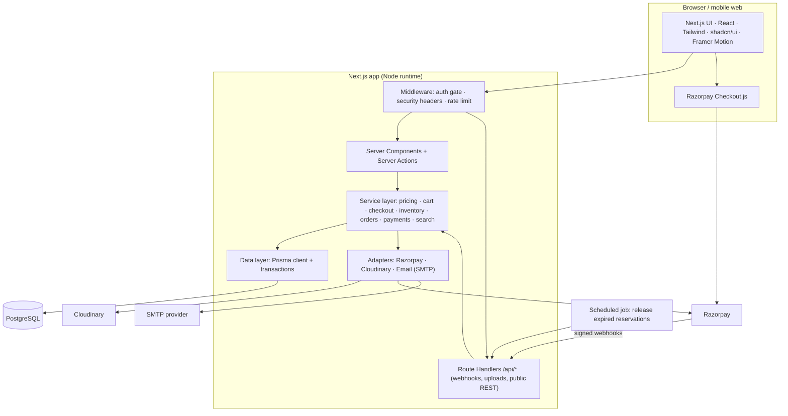
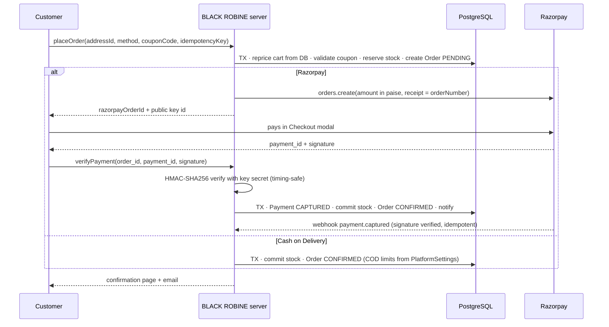

# BLACK ROBINE — Architecture (Phase 1)

> **SHOP BEYOND ORDINARY.**
> Premium, luxury-minimalist, all-in-one marketplace · India · INR (₹) · English

---

## 1. Brand tokens (official)

| Token | Value | Use |
|---|---|---|
| `--br-black` | `#111111` | Primary: buttons, headings, nav, admin chrome |
| `--br-ivory` | `#FFFFFF` | Secondary: cards, inputs, inverse text |
| `--br-bg` | `#F8F7F4` | Page background (warm ivory) |
| `--br-gold` | `#C5AD89` | Accent: highlights, focus rings, badges, rules |
| `--br-text` | `#252525` | Body text |
| `--br-muted` | `#888888` | Secondary text |
| `--br-border` | `#EAE8E3` | Dividers, card borders |

The first master prompt listed the accent as `#B89B72`. The Brand Identity section is treated as authoritative, so the accent is **`#C5AD89`**.

---

## 2. Key architecture decisions

| # | Decision | Why |
|---|---|---|
| 1 | **Money is integer paise** (`Int`), never floats | No rounding drift; matches Razorpay's API |
| 2 | **Prices are GST-inclusive**; tax is derived per line from `Product.taxRate` | Standard Indian retail display (MRP incl. tax) |
| 3 | **Server is the only source of truth for prices, stock, coupons, totals** | Client values are display-only and always recomputed |
| 4 | **Order is created `PENDING` *before* payment; confirmed only by server verification or webhook** | Meets "never create/confirm an order from frontend payment success" |
| 5 | **Stock reservation**: `available = quantity − reserved` | Prevents overselling while a Razorpay payment is in flight |
| 6 | **Conditional `UPDATE … WHERE quantity − reserved ≥ n`** inside a transaction, plus DB `CHECK` constraints | Race-safe without app-level locks |
| 7 | **Webhook idempotency** via `WebhookEvent (provider, eventId)` unique | Razorpay retries; each event is applied once |
| 8 | **Auth.js with Credentials ⇒ JWT sessions** | Auth.js does not support database sessions with the Credentials provider. `Session`/`Account` tables remain for adapter compatibility and future OAuth |
| 9 | **Orders snapshot** product name, SKU, price, tax, address | History must not change when the catalogue does |
| 10 | **Soft delete** for `User` and `Product`; FKs from orders are `Restrict` | Financial history is never orphaned or cascaded away |
| 11 | **Audit trail IDs are plain strings, not FKs** | Logs survive user deletion |
| 12 | **Single seller now, `Seller` model present** | Multi-vendor later without reshaping `Product` |
| 13 | **Search = Postgres `pg_trgm`** (typo-tolerant name/brand/SKU/category) + Prisma filters | No extra infrastructure; revisit Meilisearch/Typesense only if the catalogue outgrows it |
| 14 | **Guest cart** in an httpOnly token cookie, merged into the user cart on login | "Save cart between sessions" without forcing sign-in |
| 15 | **Business rules live in `PlatformSettings`** (shipping fees, free-shipping threshold, COD limits, return window, reservation minutes) | "Do not hardcode important business logic" |
| 16 | **Login required to check out** (guest checkout is a later option) | Simplifies access control and order history |

Beyond the 27 models you listed, the schema adds the 14 below, each needed to satisfy a stated requirement:

- `VerificationToken`, `PasswordResetToken`: email verification and password reset.
- `InventoryMovement`: inventory history.
- `OrderStatusHistory`: order tracking timeline.
- `ShipmentEvent`: shipment tracking.
- `WebhookEvent`: webhook idempotency.
- `CouponRedemption`: per-user coupon limits.
- `Seller`: PDP seller info and future multi-vendor.
- `Banner`, `HomepageSection`, `Testimonial`, `ContentPage`: admin-managed homepage and content.
- `NewsletterSubscriber`, `SearchTerm`, `RecentlyViewed`: newsletter, popular searches, recently viewed.

---

## 3. System architecture



**Layering rule:** UI → (Server Action | Route Handler) → Service → Prisma. Components never import Prisma. Services never import React. Server Actions and Route Handlers stay thin: they authenticate, validate with Zod, call a service, and shape the response.

---

## 4. Critical flow — checkout and payment



**Failure paths**
- Payment failed, or reservation expired: reservation released, `Order → CANCELLED`, `InventoryMovement(RESERVATION_RELEASED)` written.
- Verify call and webhook race: both run the same idempotent `confirmPayment()`, and whichever arrives second is a no-op.
- Duplicate submit: `Order.idempotencyKey` is unique, so the second request returns the first order.

**Order status machine:**
`PENDING → CONFIRMED → PROCESSING → PACKED → SHIPPED → OUT_FOR_DELIVERY → DELIVERED`
Branches: `PENDING|CONFIRMED|PROCESSING|PACKED → CANCELLED`, `DELIVERED → RETURN_REQUESTED → RETURNED → REFUND_INITIATED → REFUNDED`.
Transitions are enforced in one function; every change writes `OrderStatusHistory` and `AuditLog`.

---

## 5. Security model

| Area | Approach |
|---|---|
| Passwords | `argon2id` (fallback `bcrypt` cost ≥ 12); never logged |
| Sessions | Auth.js JWT in httpOnly, `Secure`, `SameSite=Lax` cookie |
| RBAC | Roles `CUSTOMER / SELLER / STAFF / ADMIN`. `middleware.ts` gates `/admin` and `/account`; **every service call re-checks** (middleware is not the only guard) |
| Data ownership | Customer queries always scoped by `userId` from the session, never from request input |
| Validation | Zod on every action and route; HTML/text sanitised on write; Prisma parameterised queries; raw SQL only with `Prisma.sql` |
| Rate limiting | Login, register, forgot-password, coupon apply, search, newsletter. Upstash Redis in production, in-memory fallback in dev only |
| CSRF | Server Actions use Next's origin check; Route Handlers that mutate require same-origin + custom header; webhooks use signature auth only |
| Uploads | Signed Cloudinary uploads issued by the server (admin only); type/size allow-list; `publicId` stored for cleanup |
| Webhooks | Raw-body HMAC verification with `RAZORPAY_WEBHOOK_SECRET`, timing-safe compare, `WebhookEvent` idempotency |
| Secrets | Server-only env vars validated at boot with Zod (`lib/env.ts`); only `NEXT_PUBLIC_*` reach the browser |
| Headers | CSP, HSTS, `X-Content-Type-Options`, `Referrer-Policy`, `Permissions-Policy` |
| Audit | `AuditLog` for admin mutations, status changes, refunds, role/block changes |
| Privacy | Admin customer views show only what is needed; PII never in logs or URLs |

---

## 6. Project structure

```
black-robine/
├─ app/
│  ├─ (storefront)/            # public site, shared header/footer
│  │  ├─ page.tsx              # homepage (sections driven by HomepageSection)
│  │  ├─ c/[...slug]/          # category listing
│  │  ├─ p/[slug]/             # product detail
│  │  ├─ search/
│  │  ├─ cart/  checkout/  order-confirmation/[orderNumber]/
│  │  └─ pages/[slug]/         # ContentPage (about, shipping, returns…)
│  ├─ (auth)/                  # branded login, register, forgot/reset, verify-email
│  ├─ account/                 # customer dashboard (protected)
│  │  ├─ profile/ orders/ orders/[orderNumber]/ wishlist/ addresses/
│  │  └─ reviews/ returns/ refunds/ notifications/ settings/
│  ├─ admin/                   # admin dashboard (protected, separate layout)
│  │  ├─ page.tsx              # analytics
│  │  ├─ products/ categories/ brands/ orders/ customers/ coupons/
│  │  ├─ website/              # banners, homepage sections, content pages
│  │  └─ reports/ settings/ audit-log/
│  ├─ api/
│  │  ├─ auth/[...nextauth]/
│  │  ├─ products/ categories/ search/ cart/ wishlist/ orders/
│  │  ├─ payments/             # create, verify, refund
│  │  ├─ webhooks/razorpay/
│  │  ├─ uploads/sign/
│  │  ├─ cron/release-reservations/
│  │  └─ admin/                # analytics, exports (CSV)
│  ├─ layout.tsx  loading.tsx  not-found.tsx  error.tsx
│  ├─ sitemap.ts  robots.ts
├─ components/
│  ├─ ui/                      # shadcn/ui primitives, restyled to brand tokens
│  ├─ brand/                   # Wordmark, LoadingScreen, Footer, AnnouncementBar
│  ├─ storefront/              # ProductCard, Gallery, FilterPanel, CartDrawer…
│  └─ admin/                   # DataTable, StatCard, charts (Recharts)
├─ features/                   # vertical slices: schema (Zod) + actions + UI per domain
│  ├─ auth/ catalog/ search/ cart/ checkout/ orders/ reviews/
│  ├─ wishlist/ account/ admin/ marketing/
├─ services/                   # pure business logic, no React
│  ├─ pricing.ts  cart.ts  checkout.ts  inventory.ts  orders.ts
│  ├─ payments.ts  refunds.ts  coupons.ts  search.ts  notifications.ts
│  └─ reports.ts  audit.ts
├─ lib/
│  ├─ db.ts  env.ts  auth.ts  rbac.ts  rate-limit.ts  money.ts  slug.ts
│  ├─ razorpay.ts  cloudinary.ts  email/  (templates: order confirmation, verify, reset)
│  └─ seo.ts  (metadata + JSON-LD helpers)
├─ hooks/                      # useCart, useDebounce, useWishlist, useRecentlyViewed
├─ types/
├─ prisma/
│  ├─ schema.prisma
│  ├─ sql/001_constraints_and_search.sql
│  ├─ seed.ts                  # DEV-ONLY seed: categories, brands, sample catalogue, admin, settings
│  └─ migrations/
├─ public/                     # logo SVGs, favicon, OG image
├─ tests/
│  ├─ unit/  integration/  e2e/ (later)
├─ docs/  (this file, er-diagram.mermaid)
├─ middleware.ts
├─ .env.example
└─ package.json
```

---

## 7. API surface (Route Handlers; mutations that serve the UI also exist as Server Actions)

| Group | Endpoints |
|---|---|
| Auth | `POST /api/auth/register` · `/api/auth/[...nextauth]` (login/logout/session) · `GET/PATCH /api/me` |
| Products | `GET /api/products` (filter, sort, paginate) · `GET /api/products/:slug` · admin: `POST`, `PATCH /:id`, `DELETE /:id` |
| Categories | `GET /api/categories` · admin: `POST`, `PATCH /:id`, `DELETE /:id`, `PATCH /reorder` |
| Search | `GET /api/search?q=` · `GET /api/search/suggest?q=` · `GET /api/search/popular` |
| Cart | `GET /api/cart` · `POST /api/cart/items` · `PATCH /api/cart/items/:id` · `DELETE /api/cart/items/:id` · `POST /api/cart/coupon` |
| Wishlist | `GET /api/wishlist` · `POST /api/wishlist/items` · `DELETE /api/wishlist/items/:productId` |
| Orders | `POST /api/orders` · `GET /api/orders` · `GET /api/orders/:orderNumber` · `POST /:orderNumber/cancel` · `POST /:orderNumber/return` · admin: `PATCH /:id/status` |
| Payments | `POST /api/payments/create` · `POST /api/payments/verify` · `POST /api/webhooks/razorpay` · admin: `POST /api/payments/:id/refund` |
| Admin | `GET /api/admin/analytics` · `/customers` · `/orders` · `/reports/*.csv` |

All list endpoints are cursor- or page-paginated with a hard max page size. Errors share one shape: `{ error: { code, message, fields? } }`.

---

## 8. Roadmap

| Phase | Scope | Exit criteria |
|---|---|---|
| **1** ✅ | Architecture, ER diagram, Prisma schema, structure, roadmap | This document + schema delivered |
| **2** | Next.js scaffold, Tailwind tokens, shadcn/ui theme, `Wordmark`, loading screen, layout shell, env validation | `npm run dev` renders branded shell; lint + typecheck clean |
| **3** | Homepage + storefront shell: announcement bar, nav, hero, sections, footer | Homepage renders from DB-backed sections (seed data) |
| **4** | Product management + catalogue: listing, filters, sort, PDP, search/autocomplete | Filters/sort/pagination served from DB; trigram search live |
| **5** | Auth + customer dashboard: register, login, verify, reset, profile, addresses, wishlist | Protected routes verified; ownership tests pass |
| **6** | Cart + checkout: server pricing, coupons, shipping/tax, reservation, COD | Order created and stock committed in one transaction |
| **7** | Backend API hardening: Route Handlers, validation, error shape, pagination, rate limits | Contract tests pass |
| **8** | Admin dashboard: analytics, products, categories, orders, customers, coupons, CMS, reports/CSV | Admin-only access verified |
| **9** | Razorpay: create, verify, webhook, failure, refunds; COD finalisation | Verified against Razorpay **test mode** keys |
| **10** | Tests, security review, performance, SEO (metadata, JSON-LD, sitemap), deployment docs | CI green; deployment guide complete |

---

## 9. Environment variables

See `.env.example` in the project root. Required groups: database, Auth.js, Cloudinary, Razorpay, SMTP, rate limiting (optional in dev), cron secret, seed admin.

---

## 10. Assumptions to confirm

1. **Shipping**: flat fee plus free above a threshold (defaults ₹99 / free above ₹999), editable in settings. Tell me if you want carrier/pincode-based rates.
2. **COD**: enabled by default with a maximum order value; no extra COD fee by default.
3. **Email provider**: SMTP via an adapter (works with Resend, Brevo, SES, etc.).
4. **GST**: single rate per product (default 18%), prices tax-inclusive, no intra/inter-state CGST/SGST/IGST split on invoices yet.
5. **Razorpay and Cloudinary credentials**: not available to me, so the integration is built to run in **test mode**, and nothing is represented as live until you configure keys.
